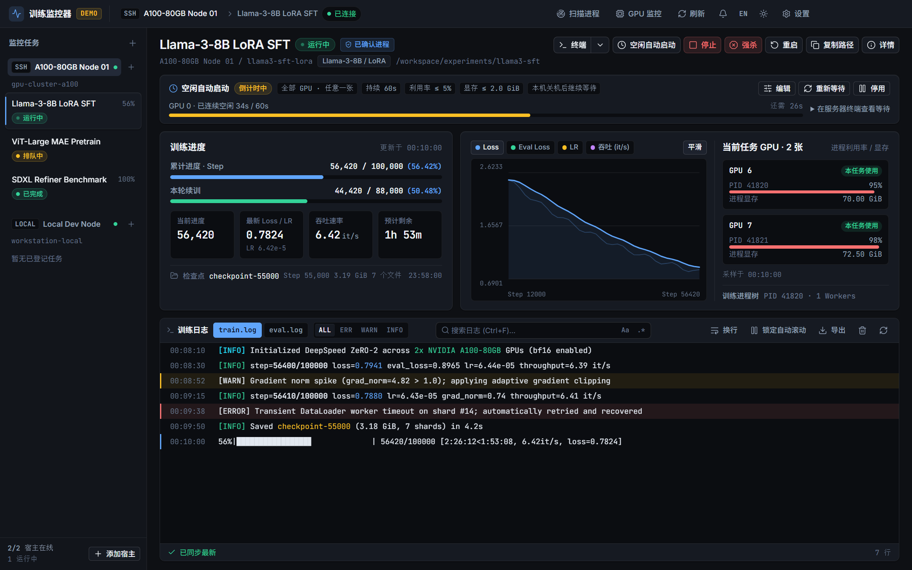
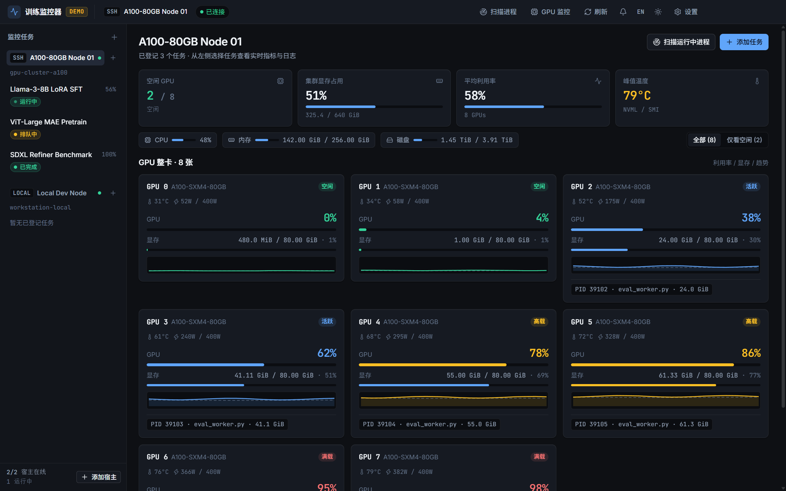
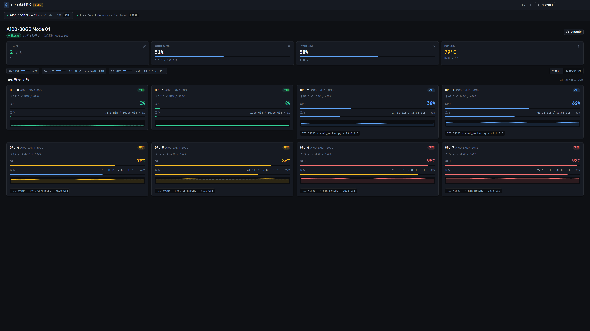
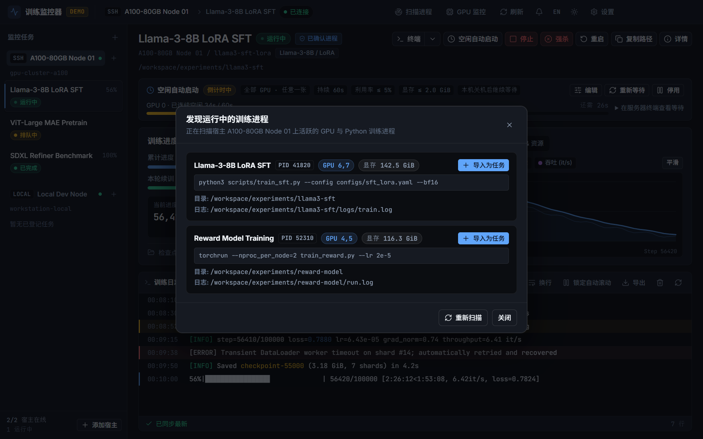
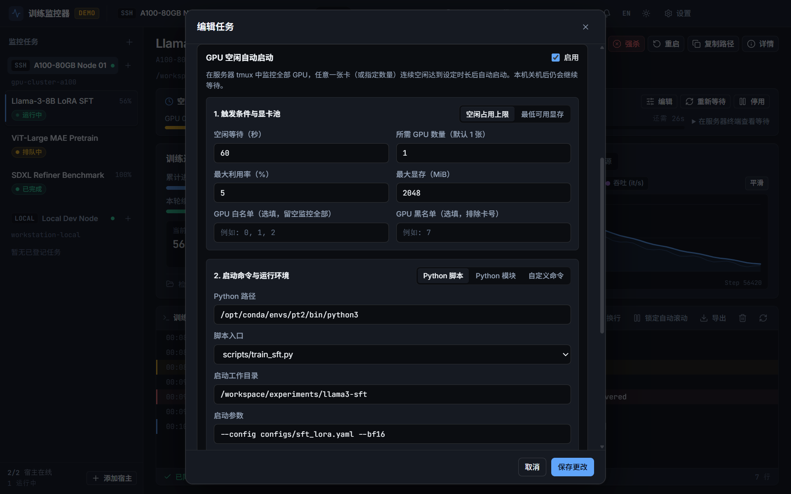
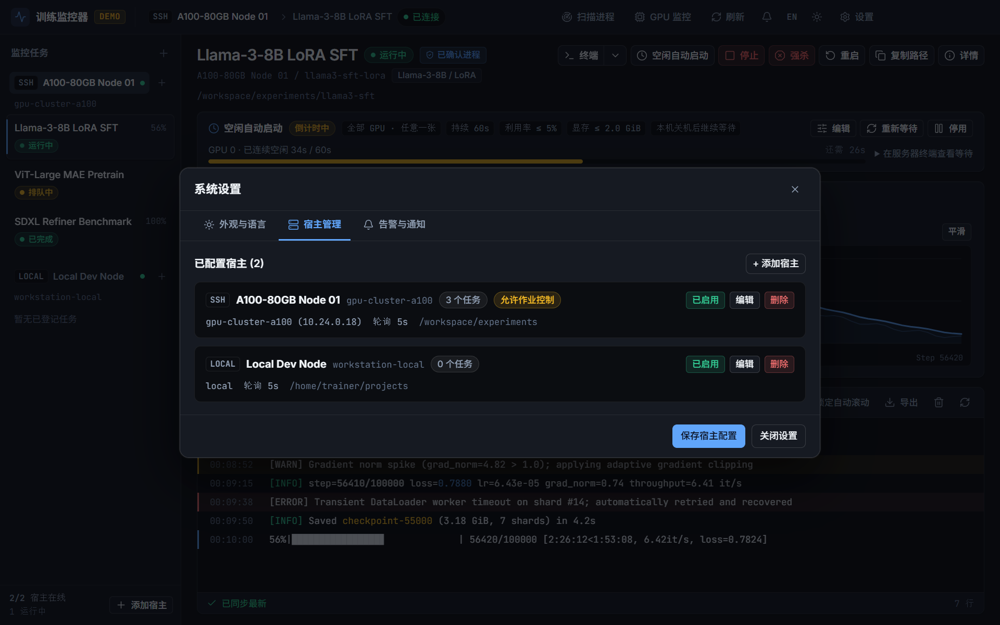
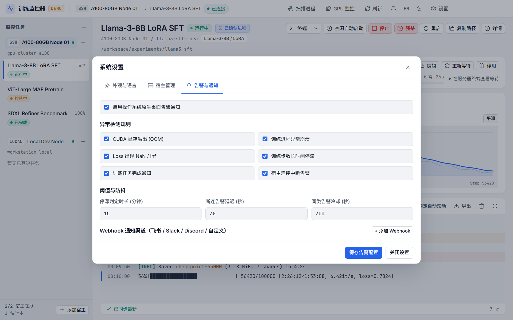
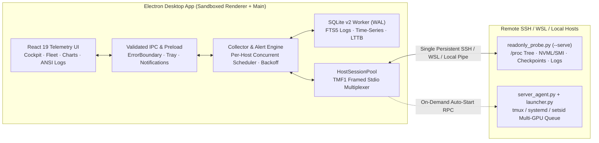

<div align="center">
  
  <h1>Training Monitor</h1>
  <p><strong>A precision desktop telemetry workstation for monitoring ML/DL training jobs across SSH servers, WSL, and local machines.</strong></p>

  <p>
    <a href="https://github.com/Noahxie83/training-monitor/actions/workflows/ci.yml">
      
    </a>
    
    
    
    
    
    <a href="./LICENSE">
      
    </a>
  </p>

  <p>
    <strong>English</strong> · <a href="./README.zh-CN.md">简体中文</a> · <a href="./DESIGN.md">Design System</a> · <a href="./CONTRIBUTING.md">Contributing</a> · <a href="./SECURITY.md">Security</a>
  </p>
</div>

<br />

<div align="center">
  <picture>
    <source media="(prefers-color-scheme: dark)" srcset="docs/assets/screenshots/cockpit-dark.png" />
    <source media="(prefers-color-scheme: light)" srcset="docs/assets/screenshots/cockpit-light.png" />
    
  </picture>
  <sub>Task Cockpit — live progress, Loss/LR curves, process-tree GPU attribution, multi-GPU auto-start countdown, and ANSI terminal log streaming. Automatically adapts to your GitHub theme.</sub>
</div>

---

## Why Training Monitor?

Monitoring long-running training jobs across shared lab GPU servers usually means juggling half a dozen `ssh`, `tmux`, `nvidia-smi`, and `tail -f` terminals — only to wake up to a silent CUDA OOM, a NaN loss spike, or idle GPUs waiting for the next run.

**Training Monitor** gives you a fast, local-first Mission-Control desktop app with **zero mandatory server installation**:

- **Zero-Daemon Passive Probing** — Connects over your existing `ssh` config, WSL distros, or local machine using a single persistent multiplexed stdio session per host (`TMF1` framed JSON-RPC) — no connection storms, no root privileges, and no Python SDK required in your training code.
- **Universal ML Framework Support** — Built for real-world training stacks: PyTorch, multi-GPU DDP/FSDP (`torchrun`, `accelerate`, `deepspeed`), HuggingFace Transformers, PyTorch Lightning, Ultralytics/YOLO, Megatron, JAX, `python -m`, `| tee` piped logs, Docker/container jobs, and CPU-only runs.
- **Layered Attribution Confidence** — Transparently distinguishes **Confirmed Process**, **Inferred Process Tree**, and **Log-Only** tracking, keeping running tasks alive through silent `torch.compile`, slow LLM steps, or long evaluation epochs.
- **Real-Time Telemetry & Local SQLite v2 History** — Persists Loss, Eval Loss, LR, throughput, GPU utilization/VRAM/temperature/power, and host CPU/RAM/disk metrics locally with LTTB downsampling and SQLite FTS5 full-text log search.
- **Multi-GPU Idle Auto-Start Queue** — Queue jobs directly on the remote server (`tmux`, `systemd-run --user`, or `setsid`) to launch automatically when **N GPUs** stay continuously idle, even after you close your laptop.
- **Proactive Alerts & 1-Click Discovery** — Detects CUDA OOM, tracebacks, `NaN`/`Inf` loss, stalled runs, completions, and host disconnects; notifies via native OS alerts and Feishu / Slack / Discord / custom webhooks; discovers running GPU/Python training processes in one click.

---

## Interface Gallery

<table>
  <tr>
    <td width="50%">
      <picture>
        <source media="(prefers-color-scheme: dark)" srcset="docs/assets/screenshots/host-overview-dark.png" />
        <source media="(prefers-color-scheme: light)" srcset="docs/assets/screenshots/host-overview-light.png" />
        
      </picture>
      <div align="center"><strong>Host Fleet Overview</strong><br /><sub>Fleet summary strip, host CPU/RAM/disk bars, 4-tier load meters, 15-min sparklines, temperature/power badges, and active GPU occupant processes.</sub></div>
    </td>
    <td width="50%">
      <picture>
        <source media="(prefers-color-scheme: dark)" srcset="docs/assets/screenshots/gpu-window-dark.png" />
        <source media="(prefers-color-scheme: light)" srcset="docs/assets/screenshots/gpu-window-light.png" />
        
      </picture>
      <div align="center"><strong>Standalone Native GPU Window</strong><br /><sub>Detachable, multi-monitor persistent window sharing the main collector's polling stream with adaptive 1/2/4-column responsive layout.</sub></div>
    </td>
  </tr>
  <tr>
    <td width="50%">
      
      <div align="center"><strong>1-Click Running Process Discovery</strong><br /><sub>Inspect live GPU & Python processes, working directories, and open log files on any host and import them straight into Task Editor.</sub></div>
    </td>
    <td width="50%">
      
      <div align="center"><strong>Multi-GPU Idle Auto-Start</strong><br /><sub>Wait for N free GPUs with allow/exclude lists, arbitrary launch commands (<code>torchrun</code>, <code>accelerate</code>, <code>python -m</code>), conda/venv/modules, and custom env vars.</sub></div>
    </td>
  </tr>
  <tr>
    <td width="50%">
      
      <div align="center"><strong>Universal Host Management</strong><br /><sub>Auto-import <code>~/.ssh/config</code> aliases, discover WSL distributions, monitor local hosts, configure polling intervals, and opt-in per-host job control.</sub></div>
    </td>
    <td width="50%">
      
      <div align="center"><strong>Anomaly Rules & Webhooks (Light Theme)</strong><br /><sub>Native desktop notifications and Feishu / Slack / Discord / custom HTTP webhooks for OOM, crash, NaN/Inf, stall, completion, and disconnects.</sub></div>
    </td>
  </tr>
</table>

---

## Core Capabilities

| Area | Highlights |
| --- | --- |
| **Multi-Host Transport** | Arbitrary SSH hosts (`~/.ssh/config` import or explicit host/user/port/key/ProxyJump), dynamic WSL distro discovery, and native `local` host support; 1 persistent multiplexed session per host + batched `probe_host_and_tasks` + exponential backoff. |
| **Process & GPU Telemetry** | Process-tree aggregation (DDP ranks + DataLoader workers + `| tee`), NVIDIA SMI/NVML with MIG & `[N/A]` support, GPU model/temp/power/fan/occupants, host CPU/RAM/disk, per-process RSS, and clean CPU-only fallback. |
| **Universal Log & Metric Engine** | ANSI 16/256/TrueColor rendering, `\r` tqdm in-place updates, dynamic `glob_latest`/`dir_latest` & symlinked `latest.log`, multi-log sources, directory-aware Checkpoint scanning (HF / DeepSpeed / Megatron / Lightning / YOLO), custom regex/JSON extractors, SQLite FTS5 search, and native log export. |
| **Multi-GPU Server Auto-Start** | Host-level FIFO coordination, N-GPU simultaneous idle detection, GPU allow/exclude lists, `index`/`uuid` `CUDA_VISIBLE_DEVICES`, arbitrary commands + conda/venv/modules + env KV map, local tmpfs sockets (NFS-safe), auto GC, bounded retry backoff, and offline `forceLocal` reconcile. |
| **Desktop Ergonomics & Security** | System tray background monitoring, close-to-tray, multi-monitor geometry persistence, taskbar progress, frameless integrated titlebar, bilingual UI (`en-US` / `zh-CN`), Atelier Light & Obsidian Dark themes, React `ErrorBoundary`, and strict opt-in audited remote job control (`SIGINT`/`SIGKILL`/restart). |

---

## Architecture



---

## Quick Start

### Prerequisites

- **Desktop Client**: Node.js `>= 22` (CI tested on Node 24) and npm; Python `>= 3.7` for local host monitoring or running Python unit tests.
- **Remote SSH Hosts**: OpenSSH access (key-based or `ssh-agent` recommended) and Python `>= 3.7` in `PATH` (or custom `pythonPath` per host). `nvidia-smi` is optional (CPU-only nodes degrade gracefully); `tmux >= 2.1`, `systemd-run --user`, or `setsid` is used only when GPU idle auto-start is enabled.

### Install & Launch

```bash
# 1. Clone the repository
git clone https://github.com/Noahxie83/training-monitor.git
cd training-monitor

# 2. Install dependencies
npm install

# 3. Build and launch the desktop app
npm start
```

Want to preview the full interface immediately without connecting a server? Launch the isolated **Demo Mode**:

```bash
npm start -- --demo
```

### Build Distributable Packages

```bash
# Windows (NSIS installer + portable zip)
npm run package:win

# macOS (DMG + zip, arm64 & x64)
npm run package:mac

# Linux (AppImage + deb)
npm run package:linux
```

---

## Keyboard Shortcuts

| Shortcut | Action |
| --- | --- |
| `Ctrl+1` … `Ctrl+9` | Switch directly to registered tasks in the fleet sidebar |
| `Ctrl+F` | Focus log search bar inside the Log Console |
| `Esc` | Close active modal, drawer, popover, or menu and restore focus |

---

## Project Structure

```text
├── src/
│   ├── collector/   # Per-host concurrent scheduler, exponential backoff, alert engine & monitor service
│   ├── desktop/     # Electron main process, tray, frameless window geometry, IPC, preload & native alerts
│   ├── domain/      # Process-tree bindings, lifecycle inference, universal progress, checkpoints & resources
│   ├── launch/      # Multi-GPU idle auto-start controller, offline reconcile & remote Python agent/launcher
│   ├── logs/        # Byte-offset cursors, continuity, ANSI/CR decoder & generation management
│   ├── mocks/       # Isolated demo fixtures & mock API
│   ├── parsers/     # ANSI-stripped universal ML parsers (HF, tqdm, JSONL, Lightning, YOLO, custom regex)
│   ├── probe/       # Zero-daemon persistent read-only Python probe (readonly_probe.py)
│   ├── registry/    # Versioned v1→v2 host/task registry, preferences & corrupt-config recovery
│   ├── renderer/    # React 19 UI, modular CSS design tokens, local WOFF2 fonts, SVG charts & zh/en i18n
│   ├── shared/      # Shared TypeScript contracts, runtime validators & budgets
│   ├── store/       # SQLite v2 Worker (WAL read/write split, FTS5, time-series LTTB, background migration)
│   └── transport/   # Persistent HostSessionPool, TMF1 framing, SSH/WSL/local commands & host discovery
├── assets/icons/    # Cross-platform app & high-DPI tray icons (.ico / .icns / .png)
├── scripts/         # Build, dev watch, runtime canary & packaged smoke test scripts
├── tests/           # Unit, domain, store, transport, simulation, Python probe/launch, UI & Electron E2E
├── docs/            # Design specs, architecture notes & showcase screenshots
└── DESIGN.md        # Design system tokens, typography & layout specification
```

---

## Development & Verification

```bash
npm run dev           # Hot-reload renderer + Electron main dev workflow
npm run typecheck     # Strict TypeScript check (including src/ and tests/**/*.tsx)
npm run test:unit     # Vitest suite (630+ unit, domain, store, transport, simulation & UI tests)
npm run test:python   # Python probe & launcher unittest suite (167 tests)
npm run build         # Production bundle (main, preload, SQLite worker, renderer)
npm run test:runtime  # Real Electron + SQLite WAL canary verification
npm run test:desktop  # Playwright Electron E2E & dual-theme visual audit (29 specs)
npm run test:all      # Run the complete verification & packaging pipeline
```

---

## Documentation

- [Design System & UI Specification](./DESIGN.md)
- [Contributing Guide](./CONTRIBUTING.md)
- [Security Architecture & Reporting](./SECURITY.md)
- [简体中文文档](./README.zh-CN.md)

---

## License

Released under the [MIT License](./LICENSE).
