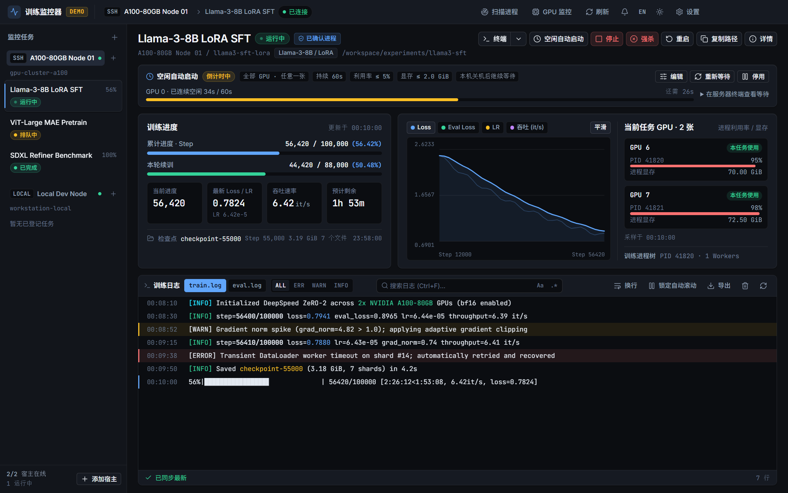
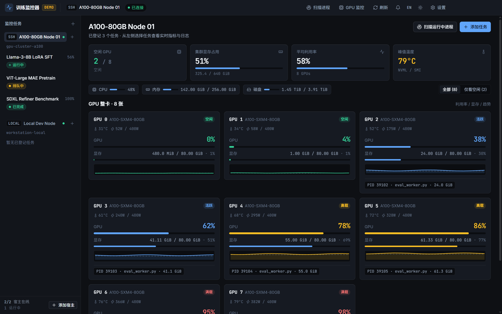
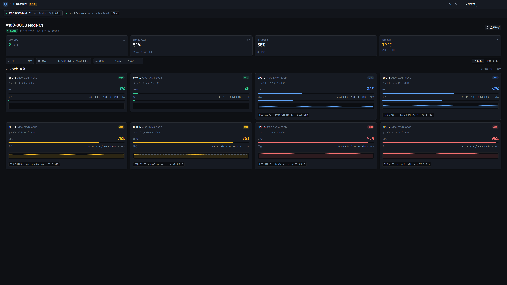
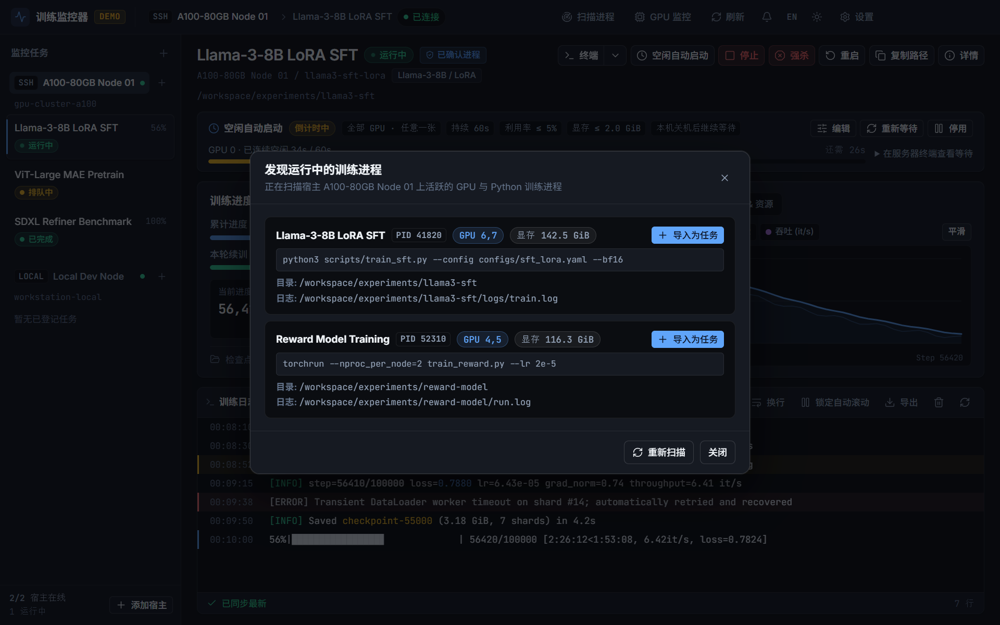
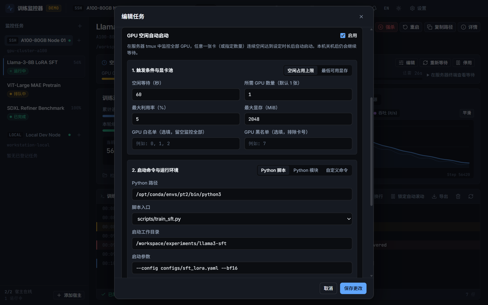
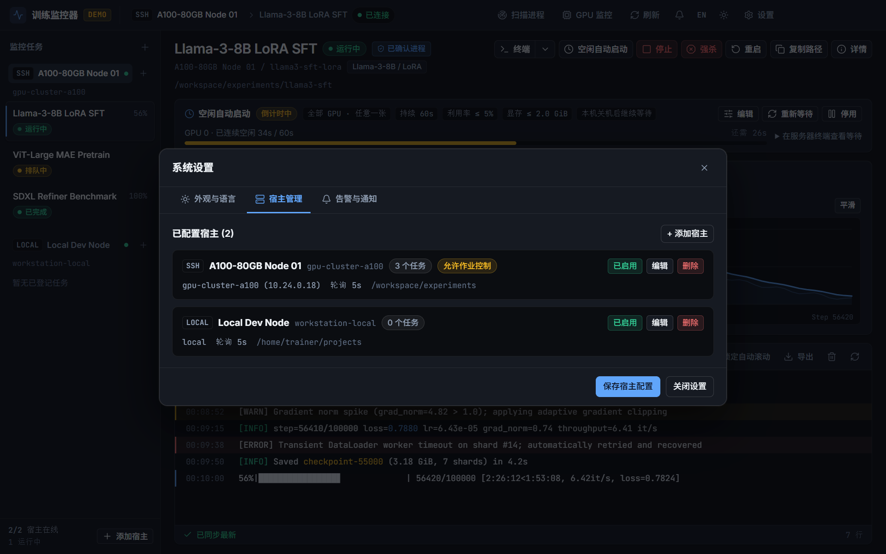
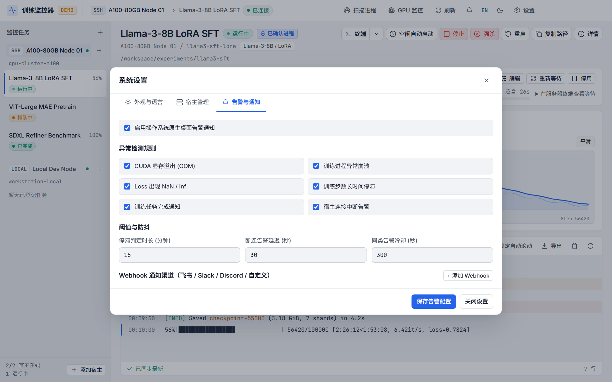
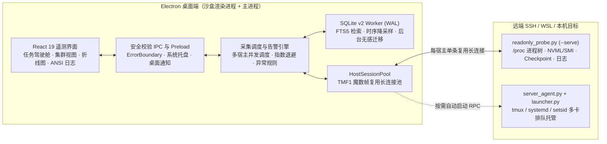

<div align="center">
  
  <h1>Training Monitor（训练监控器）</h1>
  <p><strong>面向本地、WSL 与远程 SSH 服务器的精密桌面端机器学习训练监控工作台。</strong></p>

  <p>
    <a href="https://github.com/Noahxie83/training-monitor/actions/workflows/ci.yml">
      
    </a>
    
    
    
    
    
    <a href="./LICENSE">
      
    </a>
  </p>

  <p>
    <a href="./README.md">English</a> · <strong>简体中文</strong> · <a href="./DESIGN.md">设计系统</a> · <a href="./CONTRIBUTING.md">参与贡献</a> · <a href="./SECURITY.md">安全说明</a>
  </p>
</div>

<br />

<div align="center">
  <picture>
    <source media="(prefers-color-scheme: dark)" srcset="docs/assets/screenshots/cockpit-dark.png" />
    <source media="(prefers-color-scheme: light)" srcset="docs/assets/screenshots/cockpit-light.png" />
    
  </picture>
  <sub>任务驾驶舱 —— 实时进度、Loss/LR 曲线、进程树级 GPU 归属、多卡空闲自动启动倒计时与 ANSI 彩色日志终端（自动跟随 GitHub 浅/深色主题切换预览）。</sub>
</div>

---

## 为什么做 Training Monitor？

在共享 GPU 服务器上跑长时间模型训练时，通常要在十几个 `ssh`、`tmux`、`nvidia-smi`、`tail -f` 窗口间来回切换——稍不留神就会错过半夜的 CUDA OOM、Loss 爆炸 `NaN`，或者等卡空了却没人启动下一个实验。

**Training Monitor** 提供一套本地优先、**服务器端零常驻安装**的桌面监控工作台：

- **免部署只读探针 + 长连接复用** — 直接复用本机 `~/.ssh/config`、WSL 发行版或本机环境；每台宿主仅维持一条持久化复用 stdio 通道（带 `TMF1` 魔数帧防 `.bashrc`/MOTD 污染），不制造 SSH 连接风暴、无需 root 权限、无需侵入修改训练代码。
- **全主流 ML 框架普适兼容** — 原生适配 PyTorch、多卡 DDP/FSDP（`torchrun` / `accelerate` / `deepspeed`）、HuggingFace Transformers、PyTorch Lightning、Ultralytics/YOLO、Megatron、JAX、`python -m`、`| tee` 管道日志、Docker 容器任务与纯 CPU 训练。
- **分层归属置信度** — 清晰区分 **已确认进程**、**进程树推断** 与 **仅日志追踪** 三层模式，彻底解耦进程存活与日志输出频率，大模型慢 step、长 eval 验证或 `torch.compile` 静默期均不会误报失踪。
- **本地 SQLite v2 时序与毫秒检索** — 本地持久化 Loss / Eval Loss / LR / 吞吐、GPU 利用率/显存/温度/功耗与主机 CPU/内存/磁盘曲线（LTTB 降采样），内置 SQLite FTS5 全文检索、正则高亮与日志导出。
- **多卡 GPU 空闲自动启动队列** — 支持在远端通过 `tmux` / `systemd-run --user` / `setsid` 托管等待，任意 **N 张卡** 连续空闲达标自动拉起训练，**本机关机后服务器继续等待**。
- **主动异常告警与一键进程发现** — 自动捕获 CUDA OOM、Traceback 崩溃、`NaN`/`Inf` 散度、进度停滞、训练完成与宿主断连，通过系统原生通知与 飞书 / Slack / Discord / 自定义 Webhook 及时推送；支持一键扫描宿主机正在运行的训练进程直接导入。

---

## 界面一览

<table>
  <tr>
    <td width="50%">
      <picture>
        <source media="(prefers-color-scheme: dark)" srcset="docs/assets/screenshots/host-overview-dark.png" />
        <source media="(prefers-color-scheme: light)" srcset="docs/assets/screenshots/host-overview-light.png" />
        
      </picture>
      <div align="center"><strong>宿主集群首页</strong><br /><sub>顶部集群汇总条、主机 CPU/内存/磁盘微条、四档负载色阶进度条、15 分钟迷你趋势图、温度功耗与实时占卡进程标签。</sub></div>
    </td>
    <td width="50%">
      <picture>
        <source media="(prefers-color-scheme: dark)" srcset="docs/assets/screenshots/gpu-window-dark.png" />
        <source media="(prefers-color-scheme: light)" srcset="docs/assets/screenshots/gpu-window-light.png" />
        
      </picture>
      <div align="center"><strong>独立原生 GPU 监控窗口</strong><br /><sub>支持独立拖放至副屏、多屏坐标记忆，与主窗口共享采集流零额外轮询开销，支持 1/2/4 列自适应排布。</sub></div>
    </td>
  </tr>
  <tr>
    <td width="50%">
      
      <div align="center"><strong>一键扫描运行中进程</strong><br /><sub>自动联合 <code>nvidia-smi</code> 与 <code>/proc</code> 识别正在运行的训练进程、工作目录与日志文件，点一下自动填充登记表单。</sub></div>
    </td>
    <td width="50%">
      
      <div align="center"><strong>多卡空闲自动启动</strong><br /><sub>支持 N 卡并行空闲、白/黑名单、任意命令（<code>torchrun</code> / <code>accelerate</code> / <code>python -m</code>）、conda/venv/module 激活与自定义环境变量。</sub></div>
    </td>
  </tr>
  <tr>
    <td width="50%">
      
      <div align="center"><strong>普适多宿主管理</strong><br /><sub>一键导入 <code>~/.ssh/config</code>、自动发现 WSL 发行版、支持本机 <code>local</code> 模式、自定义轮询周期与按宿主显式开启作业控制。</sub></div>
    </td>
    <td width="50%">
      
      <div align="center"><strong>异常告警与 Webhook（浅色主题）</strong><br /><sub>内置 6 类训练异常规则与防抖冷却，支持系统桌面弹窗通知与飞书 / Slack / Discord / 自定义 HTTP Webhook 测试发送。</sub></div>
    </td>
  </tr>
</table>

---

## 系统架构



---

## 快速上手

### 环境要求

- **本地桌面端**：Node.js `>= 22`（CI 基于 Node 24 验证）与 npm；如需监控本机 `local` 宿主或运行 Python 测试需 Python `>= 3.7`。
- **远程 SSH 服务器**：支持 SSH 免密登录（推荐密钥或 `ssh-agent`）与 `PATH` 中的 Python `>= 3.7`（也支持按宿主自定义 `pythonPath`）。`nvidia-smi` 非必需（无卡节点优雅降级为纯 CPU 监控）；仅在使用 GPU 空闲自动启动时需要 `tmux >= 2.1`、`systemd-run --user` 或 `setsid`。

### 安装与运行

```bash
# 1. 克隆仓库
git clone https://github.com/Noahxie83/training-monitor.git
cd training-monitor

# 2. 安装依赖
npm install

# 3. 构建并启动桌面应用
npm start
```

无需连接真实服务器即可体验完整界面的**隔离演示模式**：

```bash
npm start -- --demo
```

### 跨平台打包

```bash
# Windows（NSIS 安装包 + 便携 zip）
npm run package:win

# macOS（DMG + zip，支持 arm64 / x64）
npm run package:mac

# Linux（AppImage + deb）
npm run package:linux
```

---

## 快捷键

| 快捷键 | 功能 |
| --- | --- |
| `Ctrl+1` … `Ctrl+9` | 快速切换左侧栏中的已登记训练任务 |
| `Ctrl+F` | 聚焦日志控制台搜索框 |
| `Esc` | 关闭当前弹窗、抽屉、菜单或浮层并恢复焦点 |

---

## 开发与全链路验证命令

```bash
npm run dev           # 渲染端热更新 + Electron 开发模式
npm run typecheck     # 全量 TypeScript 类型检查（含 tests/**/*.tsx）
npm run test:unit     # Vitest 单元测试与仿真测试（630+ 用例）
npm run test:python   # Python 探针与自动启动单元测试（167 用例）
npm run build         # 生产构建（主进程、Preload、SQLite Worker、渲染端）
npm run test:runtime  # 真实 Electron + SQLite WAL 运行时金丝雀验证
npm run test:desktop  # Playwright Electron 端到端与双主题多分辨率视觉测试（29 项）
npm run test:all      # 一键执行完整回归与打包烟测
```

---

## 更多文档

- [设计系统与界面规范](./DESIGN.md)
- [贡献指南](./CONTRIBUTING.md)
- [安全模型与漏洞反馈](./SECURITY.md)
- [English Documentation](./README.md)

---

## 开源协议

本项目基于 [MIT License](./LICENSE) 开源。
